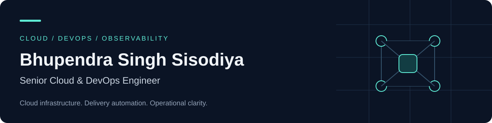

# Bhupendra Singh Sisodiya

**Senior Cloud & DevOps Engineer · Kubernetes · CI/CD · Observability**

I build and operate cloud infrastructure, automate application delivery, and make distributed systems easier to monitor and troubleshoot. My experience spans AWS and Azure, Kubernetes operations, Jenkins pipelines, and the Grafana observability stack.

[LinkedIn](https://www.linkedin.com/in/bhupendra-singh-sisodiya/) · [Email](mailto:bhupendrasinghsisodiya1604@gmail.com)

## Engineering focus

- **Cloud and Kubernetes:** cluster provisioning, scaling, maintenance, and troubleshooting across Amazon EKS and self-managed environments.
- **Delivery automation:** Jenkins pipelines, Docker images, Helm deployments, and shell scripting that reduce repetitive operational work.
- **Observability:** metrics, logs, and traces with Prometheus, Grafana, Mimir, Loki, and Tempo.
- **Operational efficiency:** infrastructure cost optimization, resource utilization, and centralized access control.

## Selected professional work

### Observability with Mimir, Tempo, and Loki

Deployed Mimir and Loki with Helm and Tempo with an operator. Integrated Prometheus remote write with Mimir, configured storage and ingress, and implemented Grafana SSO and centralized access control.

**Stack:** Kubernetes · Helm · Prometheus · Grafana · Mimir · Tempo · Loki

### Kafka and asynchronous application workloads

Deployed Kafka with Strimzi and Helm, built and deployed producer and consumer code, and integrated Celery with Django, RabbitMQ, and Redis. Used Flower to monitor background tasks and troubleshoot processing failures.

**Stack:** Kafka · Strimzi · Kubernetes · Celery · RabbitMQ · Redis · Flower

### Application delivery on Azure

Deployed a Node.js Express application to Azure App Service using Jenkins and Azure CLI, automating delivery steps and improving deployment consistency.

**Stack:** Azure App Service · Jenkins · Azure CLI · Node.js

These highlights describe professional experience. Public portfolio implementations will be linked here as they are published.

## Toolbox

| Area | Technologies |
| --- | --- |
| Cloud | AWS, Azure; additional experience with GCP, DigitalOcean, Hetzner |
| Containers | Kubernetes, Amazon EKS, Docker, Helm |
| Delivery and automation | Jenkins, GitLab, GitHub, shell scripting, Linux |
| Observability | Prometheus, Grafana, Mimir, Loki, Tempo |
| Messaging and background tasks | Kafka, Strimzi, RabbitMQ, Redis, Celery, Flower |

## Background

My experience includes DevOps engineering at **Busigence Technologies** and **Anuta Network**, and a DevOps internship at **Sirpi**. I hold a Bachelor of Engineering in Electronics and Communication from Visvesvaraya Technological University (2021).

Based in **Jhalawar, Rajasthan, India**.

## Connect

Interested in discussing Kubernetes operations, observability, or cloud delivery? Reach me on [LinkedIn](https://www.linkedin.com/in/bhupendra-singh-sisodiya/) or by [email](mailto:bhupendrasinghsisodiya1604@gmail.com).
